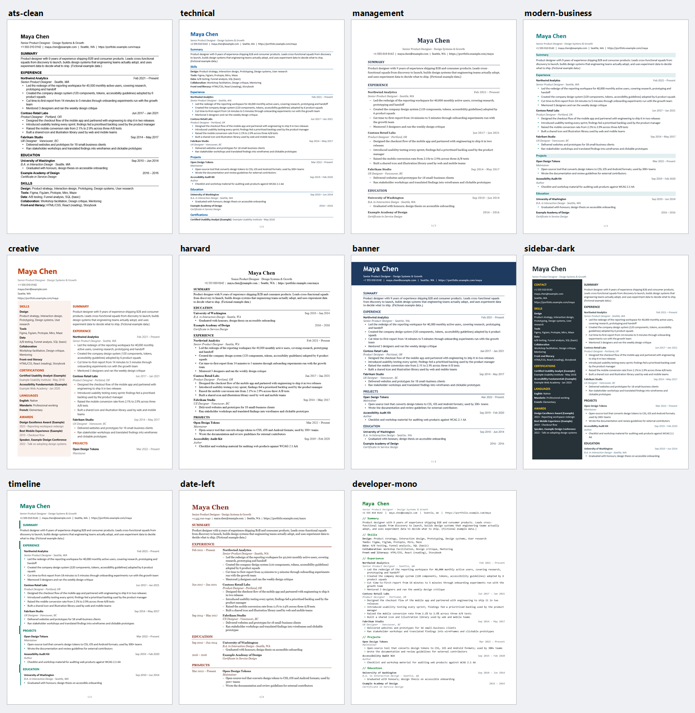

# truthful-resume — 不编造的简历生成工具

**把你的经历整理成一份好看、真实的简历：Word、PDF、Markdown 都能出。全程在你自己的电脑上完成，不联网、不上传。**

> English: an offline resume toolkit for AI coding assistants (Claude Code / Codex skills and copy-paste prompts for other chat models).
> It never invents facts, renders 11 templates to Markdown / DOCX / PDF, and runs entirely on your machine. MIT licensed.

## 它能帮你做什么

- ✍️ **从零写简历**：告诉 AI 助手你的经历，它一步步问你、整理成稿
- 🔧 **优化旧简历**：改表达、改结构，**不改你的事实**
- 🎯 **按岗位调整**：贴上招聘要求，告诉你哪些满足、哪些缺证据（不会替你编）
- 🌏 **中文 / 英文**：日期、纸张、章节名自动适配
- 🎨 **11 种模板**：从最稳妥的纯文字版，到深色侧栏、时间线等设计款
- 📄 **导出 Word / PDF / Markdown**，生成后自动检查

## 和别的简历工具有什么不同

1. **不编造**：缺的信息会留成醒目的 `{{MISSING:电话}}` 提醒你补；AI 改写的内容要你确认；没有的证书、数据不会被写进去。
2. **完全离线**：不联网、不需要账号和密钥，你的简历不会离开你的电脑。
3. **会告诉你哪些要自己把关**：生成后检查日期、重复、缺项，并列出"需要你亲自核对"的地方。**文件生成成功不等于可以投递。**

## 模板预览



| 模板 | 适合谁 | 机器筛选友好* |
|---|---|:--:|
| `ats-clean` | 网上投递：纯文字、单栏 | ✅ |
| `harvard` | 学生、学术、金融：经典，教育在前 | ✅ |
| `technical` | 程序员 / IT：紧凑，技能靠前 | ✅ |
| `management` | 管理层：稳重、留白多 | ✅ |
| `modern-business` | 一般岗位（默认） | ✅ |
| `timeline` | 想突出成长脉络：左侧一条时间线 | ✅ |
| `banner` | 醒目的彩色抬头 | ❌ |
| `sidebar-dark` | 深色侧栏，信息密度高 | ❌ |
| `date-left` | 日期在左、内容在右 | ❌ |
| `creative` | 设计类岗位：双栏 | ❌ |
| `developer-mono` | 程序员的终端风格 | ❌ |

\* 很多公司用系统（ATS）先自动筛简历。标 ❌ 的版式好看，但机器可能读不准，**网上投递请用 ✅ 的版本**，工具会提醒你同时生成一份。单个模板的大图在 [`docs/images/`](docs/images/)。

## 快速开始（Windows）

需要：Python 3.12（只在这个版本测试过）。要导出 PDF，还需要安装 Microsoft Word（或 LibreOffice，后者未测试）。

```bash
git clone https://github.com/lllllukewatchme-alt/truthful-resume.git
cd truthful-resume
python scripts/generate_resume.py --input examples/sample_resume_rich.json --output-dir out --formats md,docx,pdf --template modern-business
```

稍等片刻，`out/` 文件夹里就有 Word、PDF 和 Markdown 三份简历，还有一份检查报告。把 `--template` 换成上表任意名字就能换风格。
想用自己的内容：复制 `examples/` 里的示例，改成你的信息（示例全是虚构的），再把 `--input` 指向它。

## 搭配 AI 助手使用

| 你用的工具 | 怎么用 | 状态 |
|---|---|---|
| **Claude Code** | `python scripts/install_skill.py --target claude-code-user`，然后对它说"帮我做一份简历" | 按官方文档做的，**尚未在 Claude Code 里实际验证** |
| **Codex** | `python scripts/install_skill.py --target codex-user` | 按官方文档做的，**尚未在 Codex 里实际验证** |
| **DeepSeek / 豆包 / 其他聊天模型** | 复制 `adapters/` 里对应的 `PROMPT.md` 发给它；它给你一段简历数据，你保存后用上面的命令生成 | 人工流程，**未实测**；聊天模型自己不能生成文件 |

安装前可以加 `--dry-run` 预览，默认不会覆盖已有内容。

## 常用命令

把 `你的文件.json` 换成你自己的文件名（可以复制 `examples/` 里的示例来改）。结果都放在 `out/` 文件夹里。

| 想做什么 | 命令 |
|---|---|
| 做一份简历（Word + PDF + Markdown） | `python scripts/generate_resume.py --input 你的文件.json --output-dir out --formats md,docx,pdf` |
| 换个模板 | 在上一条命令后面加 `--template timeline`（名字见上面的模板表） |
| 只检查，不生成 | `python scripts/validate_resume.py --input 你的文件.json` |
| 看简历和招聘要求对不对得上 | `python scripts/match_jd.py --input 你的文件.json --jd 招聘要求.md` |
| 看电脑能不能导出 PDF | `python scripts/inspect_environment.py` |

## 简历的四种状态

每次生成后，报告第一行会告诉你这份简历走到了哪一步：

| 状态 | 意思 | 你要做什么 |
|---|---|---|
| `draft` 草稿 | 有错误，比如缺姓名、日期写错 | 按提示先改 |
| `needs_review` 需要核对 | 还有没填的 `{{MISSING}}`，或 AI 改写的内容等你确认 | 补全、确认，再重新生成 |
| `validated` 通过检查 | 自动检查都过了 | 自己再核对一遍事实和联系方式 |
| `ready_to_submit` 可投递 | 你亲自确认过才会出现（命令里加 `--confirm-ready`） | 可以投递了 |

工具不会自己宣布"可投递"，这一步只能由你来决定。

## 遇到问题

- **PDF 导出失败**：说明电脑上没有 Word / LibreOffice。工具会明确报错，不会生成假 PDF。用 Word 打开生成的 `.docx`，另存为 PDF 即可。
- **会不会覆盖我的文件**：不会。重名时自动加 `-1`、`-2`；只有你明确加 `--force` 才覆盖，并且不会覆盖你的输入文件。
- **中文显示不正常**：先运行 `python scripts/inspect_environment.py`，看看是否检测到中文字体。

## 实际验证过什么

- ✅ **已验证**：Windows 11 + Python 3.12 + Word 16 上，生成 Markdown / Word、导出 PDF、中英文、11 个模板（共 175 个自动测试，174 通过，1 个因没装 LibreOffice 被跳过）。
- ❓ **没验证**：Claude Code / Codex / DeepSeek / 豆包里的实际表现、LibreOffice、macOS / Linux、旧版 Python、各公司招聘系统的真实解析结果。
- ⚠️ **限制**：不能读取旧的 Word/PDF 版式；不支持照片；JD 匹配只是关键词比对，需要你自己判断。

## 更多文档

- 📘 [完整使用手册](docs/USAGE.md)：全部命令参数、安装、平台说明
- 🤝 [参与贡献](CONTRIBUTING.md) · 🔒 [安全说明](SECURITY.md) · 📝 [更新记录](CHANGELOG.md)
- 📮 **反馈与建议**：欢迎在 [Issues](https://github.com/lllllukewatchme-alt/truthful-resume/issues) 提出（请只附虚构的示例数据，不要附真实简历），也可发邮件到 lllllukewatchme@gmail.com
- 📄 许可证：[MIT](LICENSE)
